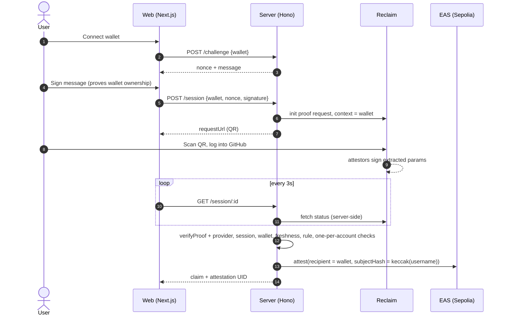

# zktls-expert

Prove a GitHub fact (an account, or a contribution count above a threshold) straight from github.com with a
**Reclaim Protocol zkTLS proof**. The server verifies the proof and the browser shows the verified claim.
Built for Fai's expert verification: a checked proof instead of a self-reported profile.

The server then issues an **EAS attestation** to the user's wallet on a **local Anvil chain**: EAS's own
contracts deployed locally, no testnet, no faucet, no real ETH. Leave the EAS settings empty for verify-only
mode (nothing on-chain), or point them at Sepolia for a public attestation.

No credentials are shared. The user logs into GitHub inside the Reclaim flow; Reclaim's attestors witness the
TLS session and sign only the extracted values.

## How it works



Attestation schema: `string platform, bytes32 subjectHash, string claim, uint64 verifiedAt, string method`
with `platform = "github"`, `subjectHash = keccak256(lowercase username)`, `method = "reclaim-zktls"`.

## Run it

Requirements: Node 24+, a browser wallet, a phone with a camera (or open the link on desktop).

1. **Reclaim app.** At [dev.reclaimprotocol.org](https://dev.reclaimprotocol.org/), create an app and add a
   GitHub provider. Note the app ID, app secret and provider ID.
2. **Config.** `cp .env.example .env`, fill in the three Reclaim values, and set `ATTESTER_PRIVATE_KEY` to any
   fresh key (the deploy script funds it on the local chain). `RPC_URL` already points at Anvil.
3. **Install** (needs [Foundry](https://getfoundry.sh/) for `anvil`).
   ```bash
   npm --prefix server ci && npm --prefix web ci && npm --prefix scripts ci
   ```
4. **Local chain.** Start Anvil in its own terminal and leave it running. State is saved to `.anvil/` on exit.
   ```bash
   npm --prefix scripts run chain
   ```
   Then deploy EAS + register the schema (safe to re-run) and paste the three printed values into `.env`:
   ```bash
   npm --prefix scripts run deploy-local
   ```
5. **Start both.**
   ```bash
   npm --prefix server run dev
   ```
   ```bash
   npm --prefix web run dev
   ```
   Open http://localhost:3000.
6. **First proof.** The server logs `proof verified { params: {...} }`. If your provider names the username or
   count differently, set `GITHUB_USERNAME_PARAM` / `CLAIM_COUNT_PARAM` / `CLAIM_MIN_COUNT` to match.

Tests (fake Reclaim + EAS, covers every attack path): `npm --prefix server test`

On-chain integration test (real attester on the running local chain, reads the attestation back):
`npm --prefix server run test:local`

Read any attestation from the local chain (stand-in for EAS Scan):
`npm --prefix scripts run read-attestation -- <uid>`

Reset everything: stop Anvil, then delete `.anvil/` **and** `server/data/` together. The server's
one-per-account store must match the chain, or it will block accounts whose attestations no longer exist.

**Sepolia instead of local:** set `RPC_URL` to a Sepolia RPC, `EAS_ADDRESS=0xC2679fBD37d54388Ce493F1DB75320D236e1815e`,
`SCHEMA_REGISTRY_ADDRESS=0x0a7E2Ff54e76B8E6659aedc9103FB21c038050D0`, `EXPLORER_URL=https://sepolia.easscan.org`,
fund the attester, and run `npm --prefix scripts run register-schema`.

## Trust model

- **We trust Reclaim's attestors and TLS.** A proof means "a Reclaim attestor saw github.com return these
  values over TLS". If attestors collude, they can forge a proof.
- **We trust our server.** It is the EAS attester, so a reader of the attestation trusts this server's
  verification logic and key. The attestation says *this verifier* checked the proof, not that the chain did.
- **We don't trust the browser.** The proof is fetched from Reclaim by the server, never relayed by the client.
  The client only supplies a wallet address, and must sign a fresh server nonce to prove it owns it.
- **What is checked before attesting:** SDK `verifyProof` against the pinned provider ID and version (attestor
  signatures + provider hash), exactly one proof, session ID in the signed context matches a session we created,
  context address matches the signing wallet, proof is newer than the session, claim rule passes, the GitHub
  account and the proof have never been attested before.

## Limitations

- One process, in-memory sessions and challenges, JSON-file store. Restarting drops in-flight sessions.
- `subjectHash` is `keccak(username)`: GitHub usernames are public, so anyone can test whether a given
  username is attested. It hides the username from casual reads, not from a determined one.
- Only EOAs can sign the challenge (no EIP-1271 smart-contract wallets).
- With EAS enabled: one attestation per GitHub account, forever, and revoking is manual. In verify-only mode nothing persists beyond the session, so the verified claim exists only in the browser and server log.
- No rate limiting on `/challenge` or `/session`; each session calls Reclaim's API.
- The claim rule is a single username field plus an optional numeric threshold.

## Next steps

- **On-chain Reclaim verifier.** Verify the proof in a contract (EAS resolver) so the attestation doesn't depend
  on trusting this server.
- Postgres with unique constraints for sessions and the one-per-account store; Redis for challenges.
- Salted/HMAC subject hash, EIP-1271 signatures, rate limits, and a re-verification path that revokes the old
  attestation.
