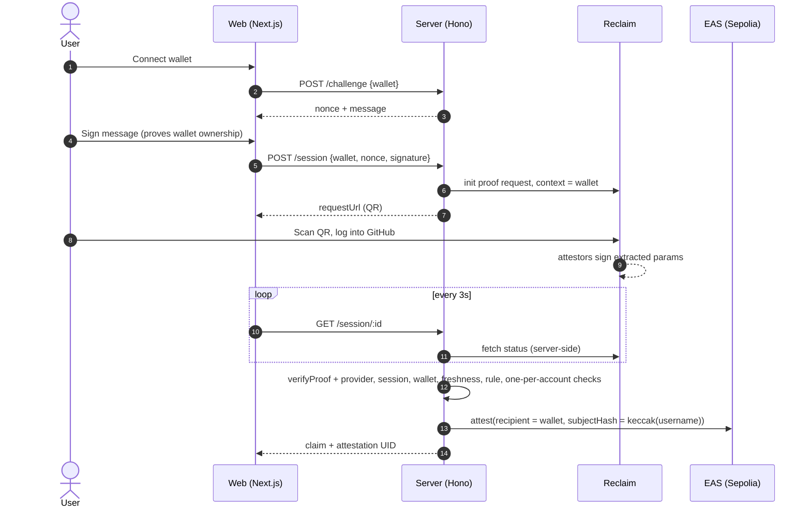

# zktls-expert

Prove a GitHub fact (an account, or a contribution count above a threshold) straight from github.com with a
**Reclaim Protocol zkTLS proof**, and receive an **EAS attestation** on Sepolia in your wallet. Built for Fai's
expert verification: the platform reads the attestation instead of trusting a self-reported profile.

No credentials are shared. The user logs into GitHub inside the Reclaim flow; Reclaim's attestors witness the
TLS session and sign only the extracted values.

## How it works



Attestation schema: `string platform, bytes32 subjectHash, string claim, uint64 verifiedAt, string method`
with `platform = "github"`, `subjectHash = keccak256(lowercase username)`, `method = "reclaim-zktls"`.

## Run it

Requirements: Node 24+, a browser wallet, a phone with a camera (or open the link on desktop).

1. **Reclaim app.** At [dev.reclaimprotocol.org](https://dev.reclaimprotocol.org/), create an app and add a
   GitHub provider. Note the app ID, app secret and provider ID.
2. **Config.** `cp .env.example .env` and fill in the Reclaim values. Generate an attester key (any fresh
   Sepolia-only key) and send it a little Sepolia ETH; `npm --prefix scripts run attester-address` prints the
   address and balance.
3. **Install.**
   ```bash
   npm --prefix server ci && npm --prefix web ci && npm --prefix scripts ci
   ```
4. **Register the schema** (once) and paste the printed `SCHEMA_UID` into `.env`:
   ```bash
   npm --prefix scripts run register-schema
   ```
   Without `SCHEMA_UID` the server still verifies proofs, it just doesn't attest. Useful for a first run.
5. **Start both.**
   ```bash
   npm --prefix server run dev
   ```
   ```bash
   npm --prefix web run dev
   ```
   Open http://localhost:3000.
6. **First proof.** The server logs `proof verified { params: {...} }`. If your provider names the username or
   count differently, set `GITHUB_USERNAME_PARAM` / `CLAIM_COUNT_PARAM` / `CLAIM_MIN_COUNT` to match.

Tests (fake Reclaim + EAS, covers every attack path): `npm --prefix server test`

## Trust model

- **We trust Reclaim's attestors and TLS.** A proof means "a Reclaim attestor saw github.com return these
  values over TLS". If attestors collude, they can forge a proof.
- **We trust our server.** It is the EAS attester, so a reader of the attestation trusts this server's
  verification logic and key. The attestation says *this verifier* checked the proof, not that the chain did.
- **We don't trust the browser.** The proof is fetched from Reclaim by the server, never relayed by the client.
  The client only supplies a wallet address, and must sign a fresh server nonce to prove it owns it.
- **What is checked before attesting:** SDK `verifyProof` against the pinned provider ID and version (attestor
  signatures + provider hash), exactly one proof, session ID in the signed context matches a session we created,
  context address matches the signing wallet, proof is newer than the session, claim rule passes, the GitHub
  account and the proof have never been attested before.

## Limitations

- One process, in-memory sessions and challenges, JSON-file store. Restarting drops in-flight sessions.
- `subjectHash` is `keccak(username)`: GitHub usernames are public, so anyone can test whether a given
  username is attested. It hides the username from casual reads, not from a determined one.
- Only EOAs can sign the challenge (no EIP-1271 smart-contract wallets).
- One attestation per GitHub account, forever. No re-verification or update flow; revoking is manual.
- No rate limiting on `/challenge` or `/session`; each session calls Reclaim's API.
- The claim rule is a single username field plus an optional numeric threshold.

## Next steps

- **On-chain Reclaim verifier.** Verify the proof in a contract (EAS resolver) so the attestation doesn't depend
  on trusting this server.
- Postgres with unique constraints for sessions and the one-per-account store; Redis for challenges.
- Salted/HMAC subject hash, EIP-1271 signatures, rate limits, and a re-verification path that revokes the old
  attestation.
